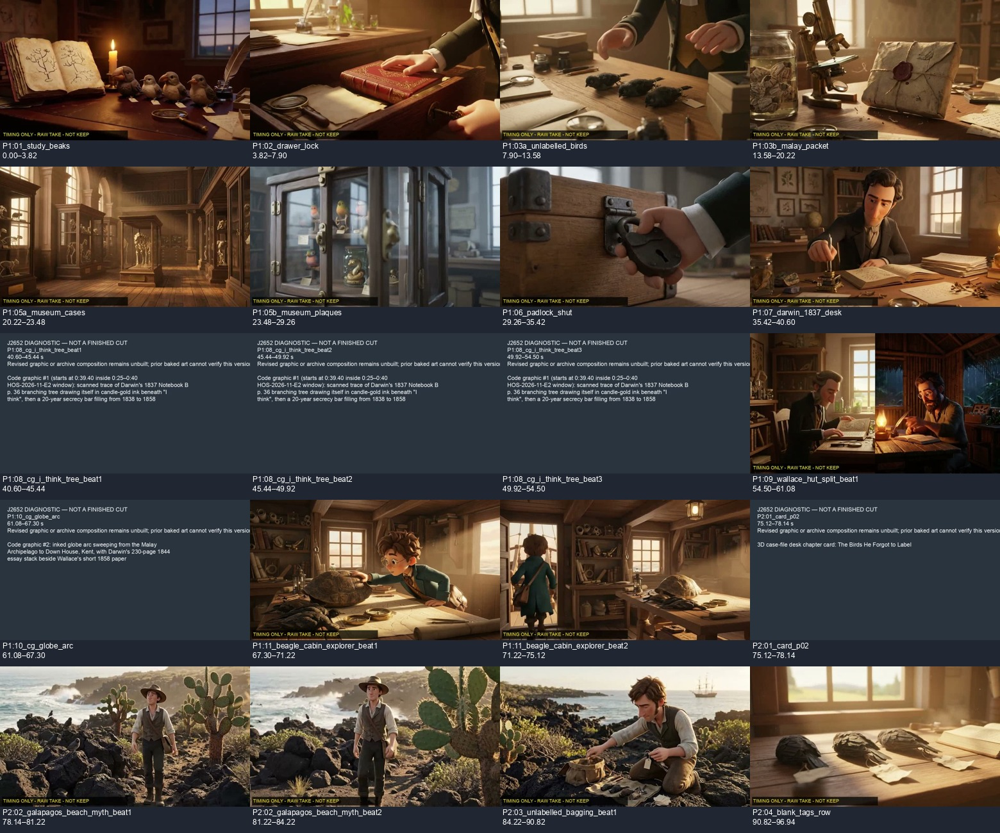
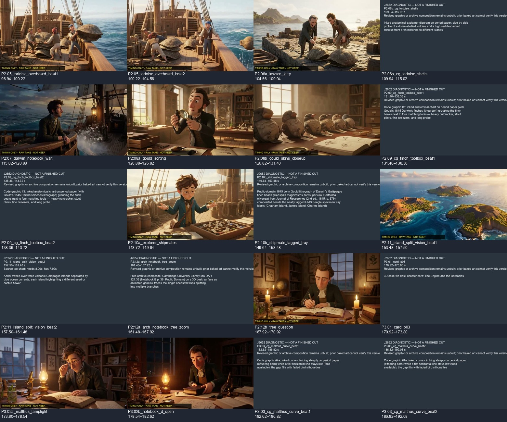
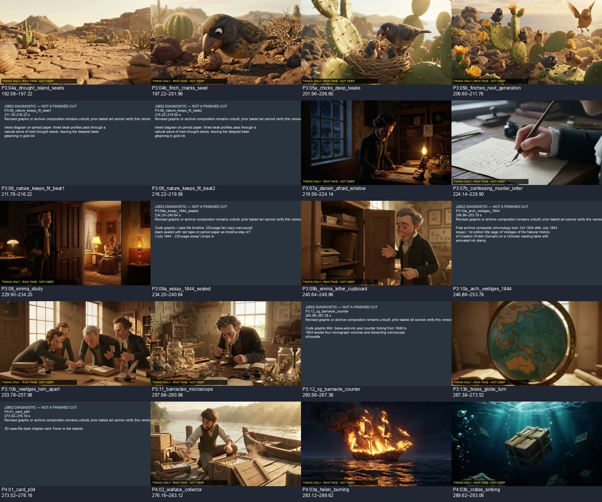
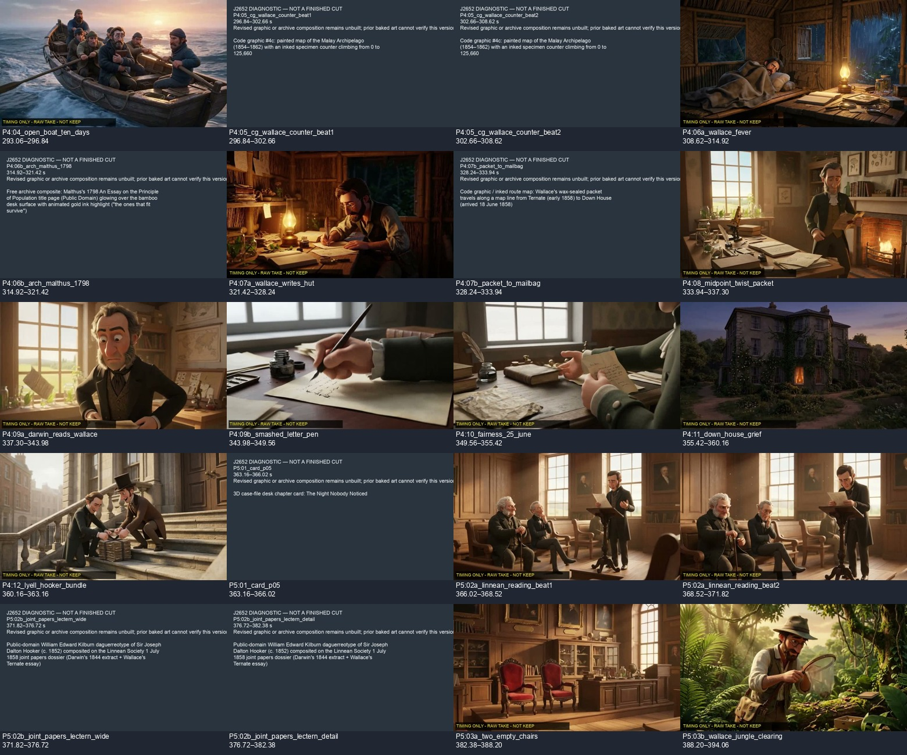
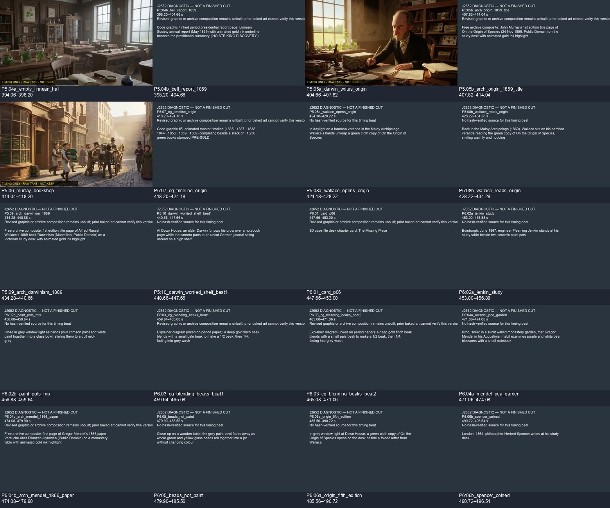
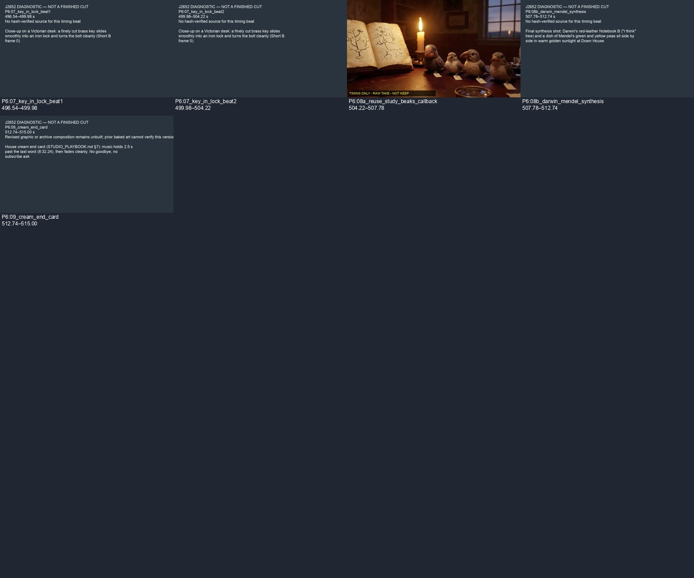

# J2652: v03d removes the three flash beats; diagnostic only

13 November 2026, Codex. Continues ruling 6808560760 and PR #551.
No audio, v02, previous plan, previous rough, generation approval or film approval changed.
No money or subscription credits spent.

## Timing revision

- 105 beats; zero in-word cuts, unsupported cuts or planned eight-second source overruns; maximum beat 7.00 s.
- Cabin: 67.30–71.22 and 71.22–75.12 s (3.92 and 3.90 s), replacing the 0.80 s tail.
  The exact locked script line 26 has the relative clause “who didn't even label his birds properly”.
  Its end, before the main verb “stumble”, is word boundary 173 at 71.22 s. This is explicitly
  **editorial syntax evidence** under the existing clause-break rule, not invented script punctuation,
  a measured 120 ms pause, or an auditory claim. The zero-gap word boundary is retained honestly.
- Removed the 1.40 s bagging detail; the separate three-specimen/tag shot starts at 90.82 s,
  while the narration names wrens and finches and then the missing island labels.
- Paint: 456.88–459.64 s (2.76 s), now beginning on “like mixing paint” and clearing before
  the quantified beak explanation. Jenkin's preceding study shot lasts 3.88 s.
- All ordinary picture beats now last at least 2.5 s. Chapter windows remain 2.5 s;
  the narration tail has its own 2.26 s end card. All 43 cue anchors and display intervals survive.
- The locked audio hash remains 837178125a72fb250d255f1039c5cb7f8630bbb313cf23801a1155f257d796e0.
  Callback remains a trim of source 3.82–7.38 s, lasting 3.56 s, never looped or stretched.

## Seven requested checks

| Check | Result | Scope |
|---|---|---|
| 1. No in-word picture cuts | PASS | Independent word-interval test, all 104 internal boundaries. |
| 2. Qualifying boundaries, sentence preference, ceiling | FAIL overall | Word/qualified-boundary checks and 7 s ceiling pass; four sentence-preference choices below remain explicit. |
| 3. Graphics and overlays at most 8 s | PASS in plan | Picture beats at most 7 s, cue windows at most 4 s; revised art is not built/accepted. |
| 4. Locked WAV/hash | PASS | Renderer checks the unchanged J1310 WAV before using it. |
| 5. Callback at most 4.20 s, no loop/stretch | PASS in scope | 3.56 s from unused opening tail, direct trim. No new KEEP decision. |
| 6. Word-level onset audit | PASS in scope | 43 unchanged anchors/display intervals; no cue/title collisions. |
| 7. Three optional own-code replacements | PASS, not adopted | Original Quality choices retained. No unbuilt option is claimed to pass the phone sheet. |

Production clip_check on this new truthful CSV: **passed=true, 0 errors, 1 warning**.
The remaining warning is the Linnean-reading continuation, carried verbatim in clip_check_v03d.json.
Five independent tests pass. Repository check_all.sh: **ALL CHECKS PASS**.
Those are timing/repository results, not film acceptance. Overall film remains **FIX**.

## Four sentence-preference choices still explicit

sentence_preference_v03d.json lists all non-sentence cuts with a sentence window 3–7 s after their start.
These are not silently approved merely because the solver assigned a penalty:

1. Opening 3.82 s versus first sentence end 6.82 s: the later opening consumes the tail needed for the callback.
2. Padlock 35.42 s versus sentence gap 32.26–33.44 s: cutting at the latest sentence gap leaves at least
   7.16 s until the next notebook sentence at 40.60 s. Change the shot allocation if adopting that preference.
3. Part 2 title background ends 78.14 s versus sentence end 81.22 s: the next beach view currently ends
   at that same boundary. Merge/reallocate its two beach beats if extending the chapter background.
4. Jenkin 456.88 s versus sentence end 458.14 s: the later cut restores the rejected 1.50 s paint insert;
   the new cut instead uses the written comma after “children,” to put paint on its analogy.

A strict local sentence-only experiment found no complete feasible allocation with the existing shots;
that is not an impossibility proof or a waiver. Resolve these four explicitly before timing PASS.

## New diagnostic renderer and continuation

_build_timing_rough_J2652_v03d.py uses exact archive first-take filenames and verifies their saved SHA-256
receipts. Raw takes are visibly marked **TIMING ONLY – RAW TAKE – NOT KEEP**. Secondary beats use a
centred 88% diagnostic detail crop, which still needs subject/framing review. A source that is too short
becomes an explicit slate; it is never slowed, looped, frozen or silently substituted.
All revised graphics/archive compositions stay explicit slates rather than showing old baked labels as
new timing evidence. Cue subtitles use display_start_s/display_end_s, not the old onset-plus-hold formula.
The old audio is muxed, with no speech changes; this diagnostic has no music or SFX.

Detached run: tmux **J2652-v03d-r4**; log **~/_desk/logs/J2652-v03d-r4.log**;
completion file **~/_desk/logs/J2652-v03d-r4.done**. The first three attempts exited before rendering a
usable row (Python selection, a versioned input filename, unsupported ffmpeg drawtext); their logs are
retained. The current run uses the explicit installed Python and a Pillow/overlay watermark.
The run completed with exit 0. The 515-second master and six 390 px phone/contact sheets were
copied to the film's NAS timing_rough_J2652 folder and hash checked. Full ffmpeg video/audio decode
returned exit 0. Codex inspected all six still sheets: the visible diagnostic labels and the missing-art
slates are present; this is not a motion/audio review or a KEEP decision. There are 57 raw-footage beats
and 48 slates: 35 revised graphic/archive beats, 12 without a receipt-verified source, and one source-length
mismatch (P2:11 island_split_vision beat 2 needs the end of 8.00 s but its take is 7.917 s).
The existing Chief ruling 6822305911 permits that particular island take to be retimed to 8.00 s during
assembly; it was not silently applied here. No new generation is authorized for a missing/slated source.
The master SHA-256 is 04c98385dfe6c7e458916df9e65cc02e8bf36663cb1464365df8a10eb5b6637e.
Nothing is still rendering; do not rerun this completed version.

Remaining production work: decide the four sentence choices; build the five free sources and revised
chapter/graphic/archive compositions; map actual accepted source windows and subject-safe detail crops;
then create the finished timing rough and phone sheets. The diagnostic is not Ben's watch copy.
J2652 remains at 2/3, with this concrete checkpoint. No Ben action or credit purchase is required.

## Attached diagnostic sheets

