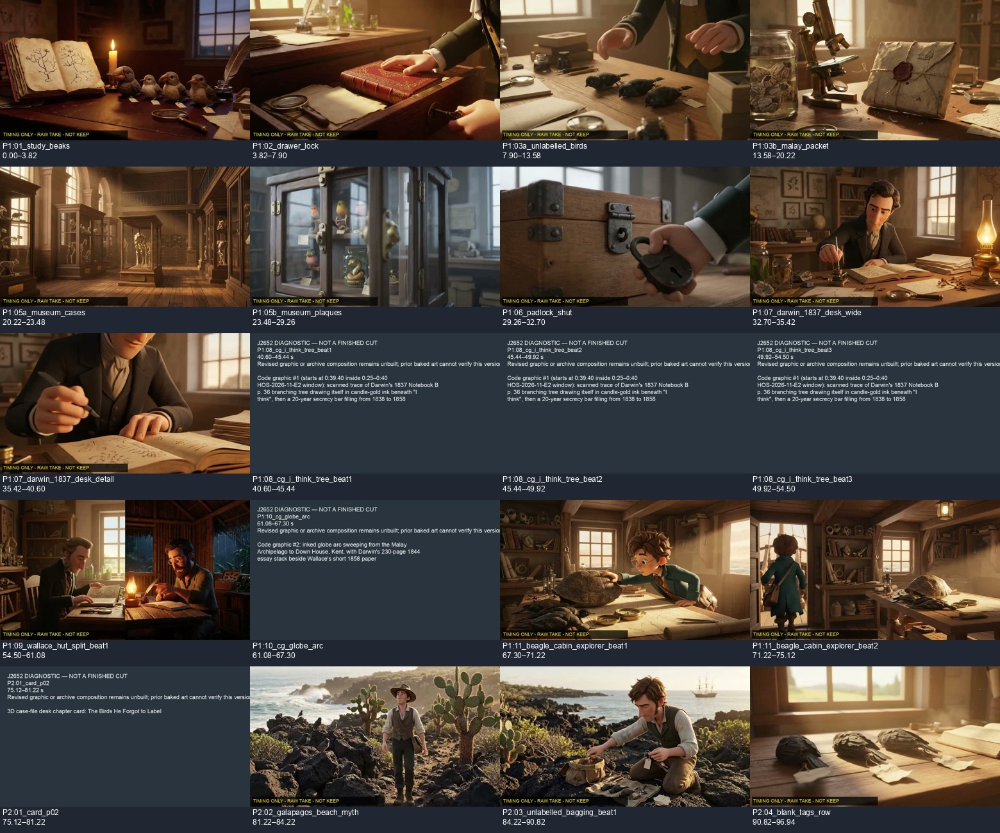
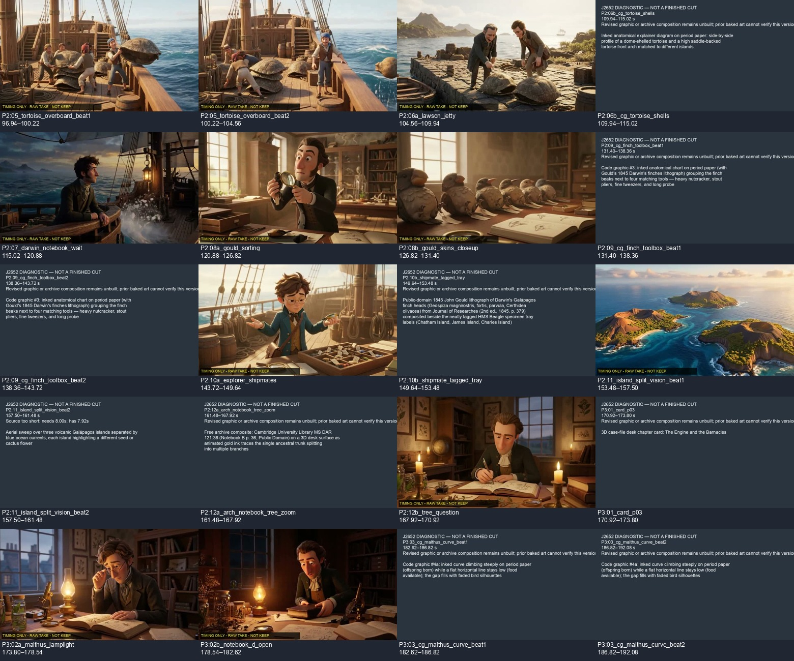
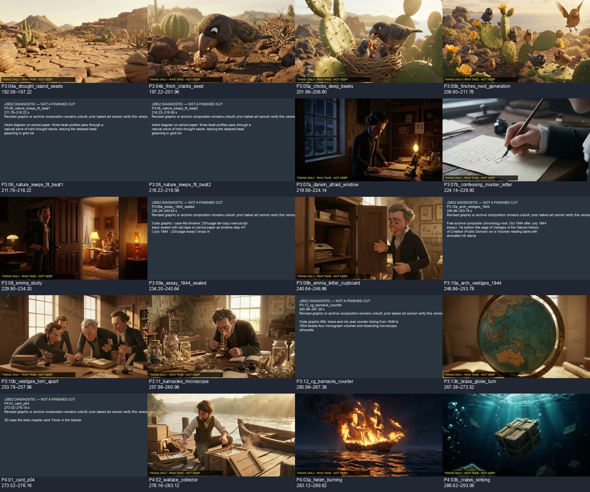
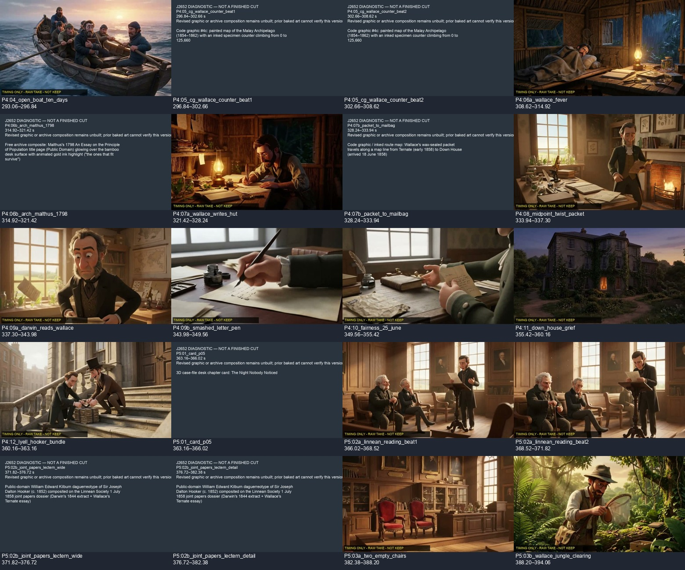
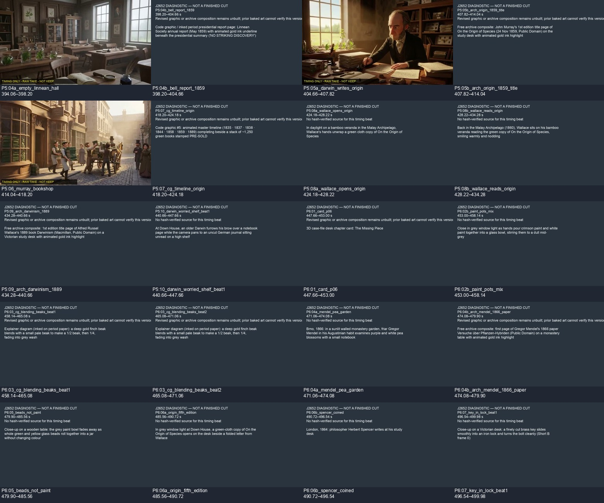
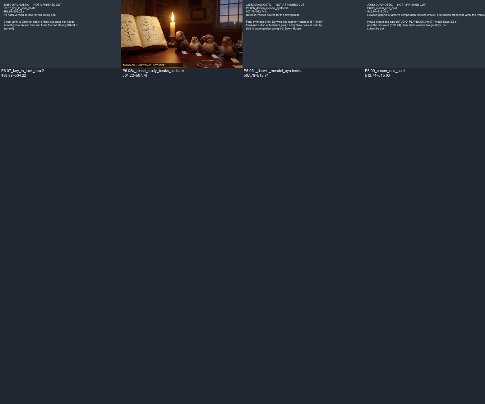

# J2652: sentence-aligned v03f scope and diagnostic — Chief review

13 November 2026, Codex worker. PR #551 remains diagnostic and unmerged.
Overall **FIX**, not film PASS or Ben's watch. No spend, generation, audio edit,
upload or other YouTube change. Earlier tracked plans and roughs are untouched.

## What changed

Three of v03d's four sentence-preference conflicts are resolved:

- Padlock ends at 32.70 s, inside the 32.26–33.44 sentence pause. Darwin's desk
  uses a wide view to 35.42 and a notebook detail to 40.60. Total native footage
  is 7.90 s, fitting the measured 7.92-second raw take. The first local experiment
  allocated 8.00 s and the renderer refused it; that experiment's v03e files and
  NAS diagnostic are preserved separately, never overwritten. v03f fixes it by
  moving the cut 100 ms within the same silent gap, with no stretching.
- Part 2 case-file background lasts 75.12–81.22, through the complete sentence.
  Its title still clears after 2.5 s. One beach view then lasts 81.22–84.22.
- Paint covers the entire blending sentence, 453.00–458.14. The separate Jenkin
  study insert is removed. His WHO keeps its original onset over the chapter
  background. Beak mechanism begins with the following conditional sentence.

There are 104 beats, all at most 7 s. No ordinary picture beat is under 2.5 s.
All 43 cue anchors/display intervals and the five chapter-title windows survive.
The whole timeline remains 515 s. The callback is still a direct 3.56-second
trim of opening-source 3.82–7.38, within the 4.20-second allowance.

## Seven requested checks (worker evidence, not Chief PASS)

| Check | Result | Evidence / limit |
|---|---|---|
| 1. No in-word cuts | PASS | Independent checks of all 103 internal boundaries. |
| 2. Qualifying cuts, sentence preference, 7 s ceiling | FAIL pending Chief interpretation | Zero unsupported cuts; ceiling passes. Three sentence conflicts fixed. Only opening remains: see below. |
| 3. Graphics/overlays at most 8 s | PASS in plan | All picture beats ≤7 s; original cue windows ≤3.8 s. Revised graphics still unbuilt. |
| 4. J1310 WAV/hash | PASS | Renderer verifies SHA-256 837178125a72fb250d255f1039c5cb7f8630bbb313cf23801a1155f257d796e0 against the unchanged NAS WAV. |
| 5. Callback allowance, no stretch/loop | PASS in diagnostic | Direct 3.56 s trim from unused opening footage; not a KEEP ruling. |
| 6. Word-level onsets | PASS in plan | 43 unchanged word anchors and display windows; no cue/chapter-title collisions. Selectable diagnostic subtitles show planned cue times; final art is absent. |
| 7. Optional own-code replacements | PASS for non-adoption | None adopted; original three Quality choices retained. No unbuilt alternative is represented as phone-approved. |

**Opening recommendation for Chief:** retain 3.82 s. Ruling 6808560760 explicitly
instructed row 1 to move from 3.80 to the nearest qualifying gap and used its
6.82-second sentence end as the example of a sentence that does not fit. That
specific example supports the current cut even though the general 3–7 s sentence
preference would flag it. The machine-readable audit retains this discrepancy;
Codex does not silently waive it. Keeping the current cut also preserves the
unused source tail for the callback. Confirm this reading before timing PASS.

## Verification

```text
Ran 6 tests in 0.016s — OK
clip_check: passed=true, rows=104, errors=[], warnings=1
ALL CHECKS PASS (repository check_all.sh)
Full ffmpeg video/audio decode: exit 0
Render: J2652-v03f-r1.done = 0
NAS COPY HASH VERIFIED
```

The one clip_check warning is the unchanged Linnean-reading continuation;
`clip_check_v03f.json` preserves it verbatim. No checker was changed this run.
These results do not approve missing pictures or certify sound/motion quality.

## Diagnostic and remaining production work

Master and six 390 px sheets are on the film NAS in
`07_Edit-Project/timing_rough_J2652/`; exact paths/hashes are in
`ROUGH_MANIFEST_v03f.json`. Master SHA-256:
`21ede5112c66f09a92fff34e4769e873b21f7e9acbb7424eb18f124292773ebf`.
Log: `~/_desk/logs/J2652-v03f-r1.log`; completion file alongside it. Nothing is
still rendering. Do not repeat this version.

57 beats use receipt-verified raw first takes, conspicuously marked NOT KEEP.
47 remain explicit slates: 35 revised graphic/archive compositions, 11 without
a receipt-verified source, and the existing island source-length mismatch
(needs 8.00 s; raw take 7.92 s). The earlier island retiming permission is recorded
in REVIEW_v03d.md; this diagnostic does not apply it implicitly.

Codex inspected all six still sheets. The desk detail now shows the notebook
and writing hand, the merged beach view is present, and the paint interval is
honestly a missing-source slate. No claim of hearing audio or watching motion.

Chief review requested on the opening interpretation and revised allocation.
The five authorized free sources and the revised compositions remain unfinished;
their zero-credit permission is not revoked and they can be built by the next
worker. Actual source/subject acceptance, final overlays, remaining free art and
a complete rough with phone sheets are still required before film acceptance.
Keep J2652 at 2/3; no Ben approval or credit purchase is needed for these tasks.

## Phone/contact evidence







